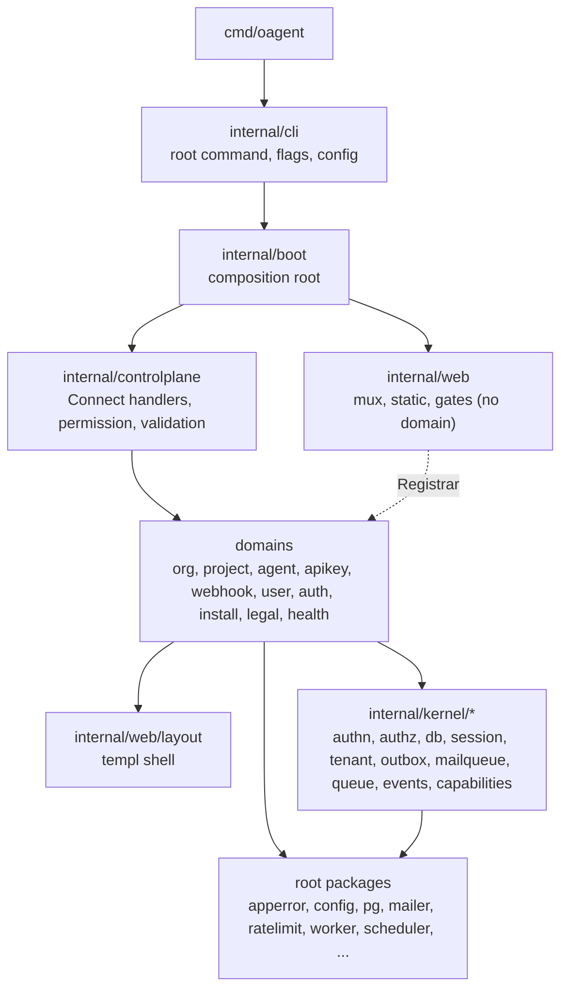

# Architecture

oagent is a self-hosted platform for AI agents. One Go binary (`oagent`, module `altalune.id/oagent`) serves every surface from one set of domain services and one Postgres database.

For step-by-step changes, see the recipes in [docs/howto](../howto/README.md).

## Surfaces

| Surface           | Where                                  | Code                                                                  |
| ----------------- | -------------------------------------- | --------------------------------------------------------------------- |
| API               | `/api` (Connect RPC, OpenAPI docs)     | `internal/controlplane`, protos in `api/`                             |
| MCP server        | `/mcp` (HTTP) and `oagent mcp` (stdio) | generated tools over the Connect handlers, `internal/mcp`, root `mcp` |
| CLI               | `oagent ...`                           | `internal/cli` (shell) + each domain's `cli.go`                       |
| Web console       | `/console`                             | Nuxt SPA in `ui/console`, embedded by `internal/web/console`          |
| Pre-sign-in pages | `/login`, `/install`, `/invite`, ...   | each domain's `web.go` + templ in `<domain>/views`                    |
| Probes            | `/healthz`, `/readyz`                  | `internal/health`                                                     |

Every signed-in surface (API, MCP, console) reaches a domain through the `controlplane` handlers, which hold the permission and reach checks. Only pre-sign-in pages, operator commands that boot the `App`, and workers call services directly.

## Layers

Import direction: `cmd` → `internal/cli` → `internal/boot` → `internal/controlplane` → domains → `internal/kernel/*`. Domains never import `internal/cli`, `internal/boot`, `internal/controlplane` or `internal/web` (only `internal/web/layout`). Kernel packages import no domain (depguard `kernel-boundary` in `.golangci.yml`).

## Boot

`internal/boot` turns `config.Config` into a running `App`: it opens the database, builds every service once, wires the surfaces and starts the workers. The order, request flow, service wiring, rate limits, Redis and workers are in [internal/boot/README.md](../../internal/boot/README.md).

## Kernel

`internal/kernel` holds the shared building blocks that domains use and that import no domain:

- `authn`, `authz`: who the caller is, and what they may do.
- `session`: the `Principal` and the browser session store.
- `tenant`: the org, project and user on the request.
- `db`: the pool and the unit of work (`RunInTx`).
- `outbox`, `mailqueue`, `queue`: durable delivery (webhooks, mail, jobs).
- `events`: the webhook event catalog.
- `capabilities`: the feature switches derived from the deployment mode.

## Domains

Each domain is a package under `internal/`: `org` (with `org/member` and `org/invite`), `project`, `agent`, `apikey`, `webhook`, `user`, `auth`, `install`, `legal`, `health`. Each uses only the files it needs: `<domain>.go`, `errors.go`, `ports.go`, `store.go` + `pg*.go`, `service.go`, then one file per surface (`controlplane.go`, `cli.go`, `web.go`), with templ views in `<domain>/views`. See [module.md](../howto/module.md).

Other internal packages: `permission` (the permission each RPC needs), `apiclient` (the CLI's Connect client), `prompt` (stdin prompts), `render` (CLI output), `mcp` (MCP auth and payloads).

## Root packages

Packages at the repo root never import `internal/`: `apperror` (error codes, `codes.json`), `config`, `pg`, `migrator`, `mailer` (+ console, smtp, resend), `ratelimit` (+ memory, redis), `worker`, `scheduler`, `httpclient`, `httpserver`, `mcp`, `password`, `sealer`, `nanoid`, `slug`, `scope`, `reqid`, `telemetry`, `version`.

## UI builds

The pnpm workspace `ui/*` builds assets that the binary embeds. The builds are not committed.

| Package      | What                           | Build             | Embedded at                   |
| ------------ | ------------------------------ | ----------------- | ----------------------------- |
| `ui/console` | Nuxt 4 console SPA             | `make ui-console` | `internal/web/console/public` |
| `ui/mcp`     | MCP Apps view                  | `make ui-mcp`     | `internal/mcp/ui/assets`      |
| `ui/web`     | Tailwind CSS + password script | `make web`        | `internal/web/static`         |

`make ui` builds all three. See [console-page.md](../howto/console-page.md) and [web-page.md](../howto/web-page.md).

## Data

Postgres only. Migrations live in `schema/migrations` and run through `migrator` (at boot with `db.autoMigrate`). Tables, keys and constraints are in [schema/README.md](../../schema/README.md). See [migration.md](../howto/migration.md).

## Code generation and dev tools

- `make generate`: protos (Go, Connect, OpenAPI, MCP tools, console TypeScript in `ui/console/gen`), scope names, error codes and templ.
- `cmd/*`: the generators and linters (`gen-apperror`, `gen-scope`, `gen-config-example`, `protoc-gen-mcp`, `comment-lint`). `protoc-gen-mcp` and `comment-lint` keep their code in `internal/tool` (`protocmcp`, `commentlint`).
- `make check`: vet, lint and tests.
