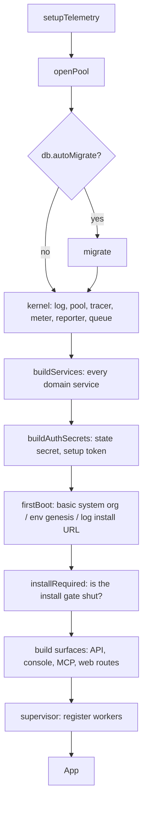
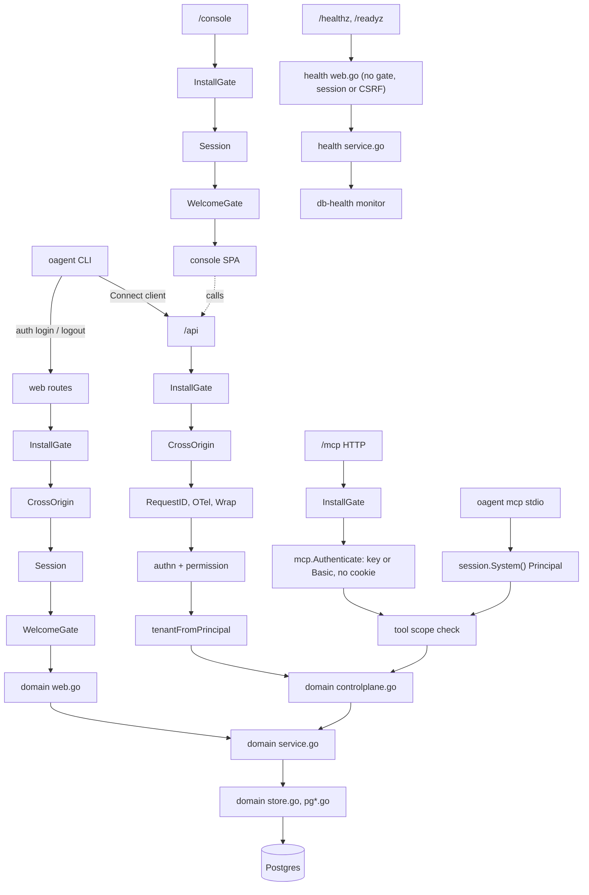
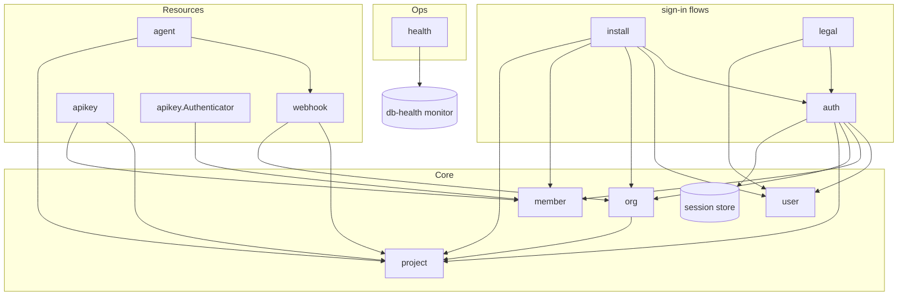

# boot

`boot` is the composition root. It turns `config.Config` into a running app:
it opens the database, builds every domain service, wires the surfaces onto
them and starts the workers. No other package wires domains together.

Keep this file in step with the code. When a domain, surface or worker is
added or removed, update the diagrams and the tables below in the same commit.

## Boot order

`Boot` (`boot.go`) runs these steps in order. Any error stops the boot.

`App.Run` starts the supervisor (`serve`). `App.RunMCP` serves MCP over stdio
instead (`oagent mcp`). `App.SetPassword` is an operator action (`oagent user
set-password`), booted with the install URL, scheduler and consumer off.
`BootRemote` (`remote.go`) is the CLI side: config, a logger and a Connect
client (`internal/apiclient`) to a running server, with no database.

## Request flow

Each surface goes through its own chain, then reaches the same domain
service. Every service writes through its own store.

- **Reach:** after the permission check, each `controlplane.go` checks that the caller reaches the org, project or resource (`kernel/authz.Reach*`). Out of reach answers 404.
- **MCP:** tools are generated from the same Connect services, so MCP and `/api` share one handler per RPC.
- **MCP scopes:** `tools/list` and `tools/call` both check the tool's scope against the caller's expanded permissions (`mcpinternal.ScopesFromContext`). Until the lockdown, no Principal holds every scope.
- **stdio:** `oagent mcp` runs as `session.System()`, an operator, never as "no Principal".

## Domains and their surfaces

| Domain | Service deps (ports) | Connect + CLI | MCP tools | Web routes |
|---|---|---|---|---|
| `org` | — | ✓ | ✓ | — |
| `org/member` | — | — | — | — |
| `project` | — | ✓ | ✓ | — |
| `agent` | webhook (publisher), project (org of project) | ✓ | ✓ | — |
| `apikey` | project (ids), member (owner roles) | ✓ | — | — |
| `webhook` | project + org (refs), project (org of project), outbox | ✓ | ✓ | — |
| `user` | — | CLI `user set-password` (operator, boots the `App`) | — | — |
| `auth` | user, member, org, project, sessions, passwords | whoami; CLI `auth login/logout/whoami` (profiles through `CLIProfiles`) | `auth_whoami` | `/login`, `/logout` |
| `install` | user, org, member, project; auth (sign-in) | — | — | `/install` + `InstallGate` |
| `legal` | user (accept terms), auth (rotate session) | — | — | `/terms`, `/privacy`, `/welcome` + `WelcomeGate` |
| `health` | readiness checks (db-health monitor) | — | — | `/healthz`, `/readyz` (probes slot, root-anchored) |

Every domain follows the same file layout: `<domain>.go`, `errors.go`,
`ports.go`, `store.go` + `pg*.go`, `service.go`, then one file per surface
(`controlplane.go`, `cli.go`, `web.go`), with templ in `<domain>/views`.

`internal/cli` is only the CLI shell: the root command, flags, config, and the
URL, token, profile and session-file resolution. Each domain's command tree is
its `cli.go` (`NewCmd`). Domains never import `internal/cli`, `internal/boot`,
`internal/controlplane` or `internal/web` (only `internal/web/layout`); the CLI's
Connect client lives in `internal/apiclient`, which imports no domain.

## Service wiring

`buildServices` (`services.go`) builds each service once and passes it to
whoever needs it. An arrow means "depends on". Small adapters in `services.go`
(`projectIDs`, `projectOrgs`, `ownerRoles`, `refResolver`) fit one service to
another domain's port.

`org → project` is the after-create hook that adds the default project.
`install → auth` and `legal → auth` exist only on the web side, wired in
`http.go`.

## Background workers

The supervisor runs these next to the HTTP server.

| Worker | What it does | When it runs |
|---|---|---|
| `http` | the HTTP server (all surfaces above) | always |
| `db-health` | pings the pool; `health` reads it for `/readyz` | always |
| `outbox` | claims due outbox entries, delivers signed webhooks | always |
| `apikey-usage` | batches `last_used_at` writes every 30 s | always |
| `scheduler` | cron jobs (expired-session sweep) | `scheduler.enabled`, unless `--no-scheduler` or consumer-only |
| queue consumer / listener | queue handlers (none yet) | when `queue.enabled` |

## Files

| File | Builds |
|---|---|
| `boot.go` | `Boot`: the order above |
| `services.go` | `Services` and every domain service, plus the port adapters |
| `auth.go` | secrets, session store, first boot, install state |
| `http.go` | API and MCP handlers and their authn chains, web routes, session middleware, CSRF, the HTTP handler |
| `mcp.go` | MCP server and its tools |
| `console.go` | console SPA handler |
| `outbox.go`, `schedulers.go`, `consumers.go`, `queue.go` | workers |
| `db.go`, `sealer.go`, `telemetry.go` | pool, migrations, health, sealer, telemetry |
| `options.go`, `app.go`, `remote.go` | boot options, the running `App` and its operator actions, the CLI graph |

## Add a domain

1. Create `internal/<domain>` with the files above. Put its consumed interfaces in `ports.go`.
2. In `services.go`, add the store and service to `Services` and build them in `buildServices`.
3. For each surface it has:
   - **Connect:** `controlplane.Services` + `server.go`, and every RPC in `controlplane/permissions.go`.
   - **CLI:** `<domain>/cli.go` (`NewCmd`), added in `internal/cli/root.go`.
   - **MCP:** `mcp.go`.
   - **Web:** `buildRoutes` in `http.go`.
   - **Readiness:** pass its check to `health.NewService` in `boot.go`.
4. Add a worker or scheduler job in `boot.go` / `schedulers.go` if it needs one.
5. Update this README: both diagrams, the domains table and the workers table.
