# schema

Postgres migrations for oagent, run by the app-agnostic `migrator` package
(goose). Files are templates: `{{.Schema}}`, `{{.TablePrefix}}`, `{{.Role}}`.
`Config.Schema` defaults to `public`; a non-empty `Config.Role` runs `SET ROLE`
on the migration connection.

Roles (`scripts/db/provision.sh`): migrations run as `oagent_migrator` with
`SET ROLE oagent_owner`, so `oagent_owner` (NOLOGIN, BYPASSRLS) owns the schema,
every table, sequence and function, and `goose_db_version`. The app logs in as
`oagent_service` (NOBYPASSRLS, no memberships, owns nothing), which gets
`SELECT, INSERT, UPDATE, DELETE` on tables, `USAGE` on sequences and `EXECUTE`
on functions through the owner's default privileges, read-only access to
`goose_db_version`, and no `CREATE` or `TEMP`. Functions are never executable by
`PUBLIC`. `scripts/db/verify.template.sql` checks all of this. Integration tests
get the same split from `pgtest.MigratedRLS` (`oagent_test_owner`,
`oagent_test_service`).

```mermaid
erDiagram
    orgs ||--o{ projects : has
    orgs ||--o{ agents : has
    projects ||--o{ agents : has
    agents ||--o{ agent_versions : "publishes"
    orgs ||--o{ model_providers : has
    projects ||--o{ model_providers : has
    orgs ||--o{ mcp_servers : has
    projects ||--o{ mcp_servers : has
    orgs ||--o{ end_users : has
    projects ||--o{ end_users : has
    end_users ||--o{ end_user_identities : "known by"
    agents ||--o{ channel_connections : "reached through"
    channel_connections ||--o{ ingest_deliveries : "has seen"
    channel_connections |o--o{ threads : "carries"
    orgs ||--o{ threads : has
    agents ||--o{ threads : "talks in"
    threads ||--o{ runs : runs
    agent_versions ||--o{ runs : pins
    threads ||--o{ messages : holds
    runs |o--o{ messages : "consumes and checkpoints"
    end_users |o--o{ messages : speaks
    end_users |o--o{ threads : "bound actor (API threads)"
    threads ||--o| thread_snapshots : "resumes from"
    orgs ||--o{ api_keys : has
    projects |o--o{ api_keys : "scopes (project keys)"
    api_keys ||--o{ api_key_projects : grants
    projects ||--o{ api_key_projects : "granted to"
    orgs ||--o{ outbox_entries : has
    projects ||--o{ outbox_entries : has
    orgs ||--o{ webhook_endpoints : has
    projects ||--o{ webhook_endpoints : has
    webhook_endpoints ||--o{ webhook_deliveries : logs
    users ||--o{ memberships : has
    orgs ||--o{ memberships : has
    users |o--o{ orgs : "created_by"
    users |o--o{ api_keys : "created_by (owner of personal keys)"
    users ||--o{ sessions : owns
    users ||--o{ password_resets : requests
    orgs ||--o{ invites : has
    users ||--o{ terms_acceptances : accepted
    legal_documents ||--o{ terms_acceptances : "terms, privacy"
    users |o--o{ invites : "invited_by, accepted_by"

    orgs {
        uuid id PK
        text public_id UK
        text slug UK
        text name
        bool is_system "one row at most"
        uuid created_by FK "users, NULL in basic mode"
        timestamptz created_at
        timestamptz updated_at
    }
    projects {
        uuid id PK
        text public_id UK
        uuid org_id FK
        text slug "unique per org"
        text name
        text environment "production, staging, development, labs or empty (no tag)"
        uuid created_by
        timestamptz created_at
        timestamptz updated_at
    }
    agents {
        uuid id PK
        text public_id UK
        uuid org_id FK
        uuid project_id FK "(org_id, project_id) -> projects"
        text slug "unique per project"
        text name
        text description
        jsonb draft_config "the config being edited; an object"
        timestamptz draft_updated_at "NULL until the draft is first edited"
        int published_version "latest version, 0 before the first publish"
        timestamptz published_at "last publish, a no-op publish too"
        uuid created_by
        timestamptz created_at
        timestamptz updated_at
    }
    agent_versions {
        uuid id PK
        text public_id UK
        uuid org_id FK
        uuid project_id FK
        uuid agent_id FK "(org_id, project_id, agent_id) -> agents"
        int version "1, 2, 3 per agent; NULL for a draft"
        jsonb config "immutable; an object"
        uuid created_by "NULL for an API key"
        timestamptz created_at
        text kind "published or draft (a Try it pin); no default"
        bytea config_hash "a draft's config hash; NULL when published"
    }
    model_providers {
        uuid id PK
        text public_id UK
        uuid org_id FK
        uuid project_id FK "(org_id, project_id) -> projects"
        text name "unique per project"
        text kind "openai_compatible"
        text base_url
        bytea api_key_sealed "sealed"
        jsonb models "an array"
        timestamptz created_at
        timestamptz updated_at
    }
    mcp_servers {
        uuid id PK
        text public_id UK
        uuid org_id FK
        uuid project_id FK "(org_id, project_id) -> projects"
        text name "unique per project; lowercase, digits, dashes, at most 32"
        text url
        text auth_kind "none, bearer or header"
        text auth_header "header name, set only for header auth"
        bytea auth_sealed "sealed, NULL only for none"
        int timeout_ms "1000 to 20000"
        bool trusted
        timestamptz created_at
        timestamptz updated_at
    }
    end_users {
        uuid id PK
        text public_id UK
        uuid org_id FK
        uuid project_id FK "(org_id, project_id) -> projects"
        timestamptz created_at
        timestamptz updated_at
        text display_name "the WhatsApp push name; at most 256"
    }
    end_user_identities {
        uuid id PK
        uuid org_id FK
        uuid project_id FK
        uuid end_user_id FK "(org_id, project_id, end_user_id) -> end_users"
        text kind "api_user, wa_phone, wa_lid, widget_anon, widget_sub"
        text value "1 to 256 characters; phone numbers and LIDs live only here"
        timestamptz created_at
    }
    threads {
        uuid id PK
        text public_id UK
        uuid org_id FK
        uuid project_id FK
        uuid agent_id FK "(org_id, project_id, agent_id) -> agents"
        text kind "dm, group, api or try"
        text external_key "unique per agent and kind, for api and try"
        text lease_owner "fresh token per claim; NULL with lease_until"
        timestamptz lease_until
        bool cancel_requested
        bigint next_seq
        timestamptz created_at
        timestamptz updated_at
        uuid actor_end_user_id FK "(org_id, project_id, actor_end_user_id) -> end_users; the first actor of an API thread"
        uuid connection_id FK "(org_id, project_id, connection_id) -> channel_connections; channel threads only, NULL once the connection is deleted"
        text channel_address "the group JID of a group thread"
        text reply_via "wa_phone or wa_lid"
    }
    channel_connections {
        uuid id PK
        text public_id UK
        uuid org_id FK
        uuid project_id FK
        uuid agent_id FK "(org_id, project_id, agent_id) -> agents"
        text provider "openwa"
        text status "active or disabled"
        text base_url
        text openwa_org
        text openwa_project
        text device_id "the OpenWA device public id"
        bytea signing_secret_primary_sealed "null until the secret OpenWA mints is set"
        bytea signing_secret_secondary_sealed "the rotation slot"
        bytea device_key_sealed
        int quiet_window_ms "0-10000, default 3000"
        int quiet_max_ms "at least quiet_window_ms, at most 10000"
        text reply_failure
        text reply_voice
        text reply_photo_unreadable
        text last_result "connected, device_mismatch or key_refused; set by verified outcomes only"
        timestamptz last_result_at
        timestamptz last_bad_signature_at "never changes last_result"
        timestamptz created_at
        timestamptz updated_at
    }
    ingest_deliveries {
        uuid org_id FK
        uuid project_id FK
        uuid connection_id PK "(org_id, project_id, connection_id) -> channel_connections"
        text delivery_id PK
        timestamptz received_at
    }
    runs {
        uuid id PK
        text public_id UK
        uuid org_id FK
        uuid project_id FK
        uuid thread_id FK "(org_id, project_id, thread_id) -> threads"
        uuid agent_version_id FK "(org_id, project_id, agent_version_id) -> agent_versions"
        text status "running, awaiting_approval, completed, failed, cancelled, interrupted, limit_reached, expired"
        text idempotency_key "unique per thread when set"
        int attempt ">= 1"
        bigint input_tokens
        bigint output_tokens
        bigint cache_read_tokens
        bigint cache_write_tokens
        bool usage_estimated
        bigint price_input_micros "NULL = unpriced"
        bigint price_output_micros
        bigint price_cache_read_micros
        bigint price_cache_write_micros
        bigint cost_micros
        int latency_ms
        text error_code
        timestamptz started_at
        timestamptz ended_at
        timestamptz created_at
        timestamptz updated_at
        text reply_state "due, sent, failed or none; channel runs only"
        smallint reply_parts_sent
        smallint reply_attempts
        timestamptz reply_next_at
        bool is_group "a group thread's run; no memories reach it"
    }
    messages {
        uuid id PK
        uuid org_id FK
        uuid project_id FK
        uuid thread_id FK "(org_id, project_id, thread_id) -> threads"
        bigint seq "unique per thread"
        text role "user, assistant, tool or system"
        jsonb body "AG-UI message object"
        uuid speaker_id FK "(org_id, project_id, speaker_id) -> end_users"
        text status "pending or consumed"
        text external_message_id "unique per thread when set"
        uuid run_id FK "(org_id, project_id, run_id) -> runs"
        text tool_call_id "unique per run when set"
        timestamptz created_at
        bytea request_hash "SHA-256 of an idempotent request's canonical body"
        timestamptz channel_time "the WhatsApp message time; channel threads order by it, then seq"
        text skip_reason "stale or sender_rate: stored consumed with no run"
    }
    thread_snapshots {
        uuid thread_id PK "(org_id, project_id, thread_id) -> threads"
        uuid org_id FK
        uuid project_id FK
        uuid agent_version_id FK "(org_id, project_id, agent_version_id) -> agent_versions"
        text sdk_version
        bytea blob
        timestamptz updated_at
    }
    api_keys {
        uuid id PK
        uuid org_id FK
        uuid project_id FK "project keys only; (org_id, project_id) -> projects"
        text kind "project, org or personal"
        bool all_projects
        text name
        bytea secret_hash UK
        text secret_hint "last 4 characters; names the key on every surface (no public_id)"
        text_array scopes
        uuid_array resource_ids
        uuid created_by FK "NULL when the user is deleted"
        timestamptz created_at
        timestamptz expires_at
        timestamptz revoked_at
        timestamptz last_used_at
    }
    api_key_projects {
        uuid key_id PK, FK
        uuid project_id PK, FK
        uuid org_id FK
        timestamptz created_at
    }
    outbox_entries {
        uuid id PK
        uuid event_id
        uuid org_id FK
        uuid project_id FK "(org_id, project_id) -> projects"
        text target
        bytea payload
        int attempt
        timestamptz next_attempt_at
        text status "pending, delivered, failed"
        text last_error
        timestamptz created_at
        timestamptz delivered_at
        text public_id UK "the delivery id on the API and in the delivery-id header"
        text event_public_id "the event id in the envelope and the event-id header"
    }
    webhook_endpoints {
        uuid id PK
        text public_id UK
        uuid org_id FK
        uuid project_id FK "(org_id, project_id) -> projects"
        text url
        text description
        text event_types
        bytea secret_primary "sealed"
        bytea secret_secondary "sealed, during rotation"
        bool active
        timestamptz created_at
        timestamptz updated_at
    }
    webhook_deliveries {
        uuid id PK
        uuid org_id FK
        uuid project_id FK "(org_id, project_id) -> projects"
        uuid endpoint_id FK
        uuid delivery_id
        uuid event_id
        text event_type
        int attempt
        int status_code
        text error
        text response_body
        bool response_truncated
        text response_headers
        int duration_ms
        timestamptz created_at
    }
    users {
        uuid id PK
        text public_id UK
        text email UK "trimmed, lowercase"
        text name
        text avatar_url
        text password_hash "Argon2id PHC, empty when none"
        text idp_issuer "OIDC, set with idp_subject"
        text idp_subject
        text locale
        timestamptz terms_accepted_at
        timestamptz created_at
        timestamptz updated_at
    }
    memberships {
        uuid id PK
        text public_id UK
        uuid org_id FK
        uuid user_id FK
        text role "owner, admin, member"
        timestamptz created_at
    }
    invites {
        uuid id PK
        text public_id UK
        uuid org_id FK
        text email "normalized"
        text role "owner, admin, member"
        text token_hash UK "SHA-256 of the token, NULL only for a draft"
        bool draft "an MCP suggestion a person must confirm"
        bool email_only "install's owner seat, claimed by its verified email"
        uuid invited_by FK "NULL for a non-person operator"
        timestamptz expires_at
        timestamptz accepted_at
        uuid accepted_by FK
        timestamptz revoked_at
        timestamptz created_at
        timestamptz updated_at
    }
    legal_documents {
        uuid id PK
        text slug "terms, privacy"
        text version "the updated header value"
        text title
        text body "the markdown people accepted"
        text sha256
        timestamptz published_at
    }
    terms_acceptances {
        uuid id PK
        text public_id UK
        uuid user_id FK
        uuid terms_document_id FK
        uuid privacy_document_id FK
        text source "install, join, welcome"
        timestamptz accepted_at
    }
    mail_queue {
        uuid id PK "uuid v7, not tenant-scoped"
        bytea payload "sealed mailer.Message JSON, AAD = id, NULL once settled"
        bool sealed "false only in development with the console driver"
        text status "pending, sent, failed"
        int attempt
        timestamptz next_attempt_at
        text last_error "redacted, at most 512 bytes"
        timestamptz created_at
        timestamptz settled_at
    }
    password_resets {
        uuid id PK
        text public_id UK "held in the reset cookie"
        uuid user_id FK
        text token_hash UK "SHA-256 of the emailed token"
        timestamptz expires_at "one hour"
        timestamptz used_at "set once, by a conditional UPDATE"
        timestamptz created_at
    }
    sessions {
        text sid PK "opaque, no public_id"
        uuid user_id FK
        bytea payload "sealed Principal, AAD = sid"
        timestamptz expires_at
        timestamptz created_at
    }
```



Every foreign key to `orgs`, `projects`, `api_keys`, `webhook_endpoints` and
`users` cascades on delete, except `orgs.created_by`, `api_keys.created_by`,
`invites.invited_by` and `invites.accepted_by`, which are set to NULL.

## Constraints and indexes

Rules the diagram can't show. Names omit `{{.TablePrefix}}`. The schema needs Postgres 15 or newer: `messages_speaker_fkey` uses `ON DELETE SET NULL (speaker_id)`.

| Table                                                                                                                            | Constraint / index                                                                                                                                                                                                                                                                                                                                                                                                                                                                                                                                                                                                                                                                                                                                                                                                                                                                                                                                                                                                                        | Rule                                                                                                                                                                                                                                                                                                                                                                                                                                                                                                                                                                                                                     |
| -------------------------------------------------------------------------------------------------------------------------------- | ----------------------------------------------------------------------------------------------------------------------------------------------------------------------------------------------------------------------------------------------------------------------------------------------------------------------------------------------------------------------------------------------------------------------------------------------------------------------------------------------------------------------------------------------------------------------------------------------------------------------------------------------------------------------------------------------------------------------------------------------------------------------------------------------------------------------------------------------------------------------------------------------------------------------------------------------------------------------------------------------------------------------------------------- | ------------------------------------------------------------------------------------------------------------------------------------------------------------------------------------------------------------------------------------------------------------------------------------------------------------------------------------------------------------------------------------------------------------------------------------------------------------------------------------------------------------------------------------------------------------------------------------------------------------------------ |
| `orgs`                                                                                                                           | `orgs_one_system` (unique, `WHERE is_system`)                                                                                                                                                                                                                                                                                                                                                                                                                                                                                                                                                                                                                                                                                                                                                                                                                                                                                                                                                                                             | at most one system org; it marks the instance as installed                                                                                                                                                                                                                                                                                                                                                                                                                                                                                                                                                               |
| `projects`                                                                                                                       | `UNIQUE (org_id, slug)`, `projects_org_id_id_key UNIQUE (org_id, id)`, `projects_environment_check`                                                                                                                                                                                                                                                                                                                                                                                                                                                                                                                                                                                                                                                                                                                                                                                                                                                                                                                                       | slug unique per org; the pair is the target of org-scoped FKs                                                                                                                                                                                                                                                                                                                                                                                                                                                                                                                                                            |
| `agents`, `model_providers`, `mcp_servers`, `end_users`, `api_keys`, `outbox_entries`, `webhook_endpoints`, `webhook_deliveries` | `<table>_org_project_fkey`: `(org_id, project_id) → projects (org_id, id)`, `ON DELETE CASCADE`                                                                                                                                                                                                                                                                                                                                                                                                                                                                                                                                                                                                                                                                                                                                                                                                                                                                                                                                           | a row's project always belongs to the row's org; a NULL `project_id` (org and personal keys) is allowed                                                                                                                                                                                                                                                                                                                                                                                                                                                                                                                  |
| `agents`                                                                                                                         | `UNIQUE (project_id, slug)`                                                                                                                                                                                                                                                                                                                                                                                                                                                                                                                                                                                                                                                                                                                                                                                                                                                                                                                                                                                                               | slug unique per project                                                                                                                                                                                                                                                                                                                                                                                                                                                                                                                                                                                                  |
| `agents`                                                                                                                         | `agents_org_project_id_key UNIQUE (org_id, project_id, id)`, `agents_draft_config_object`, `agents_published_version_nonnegative` (checks)                                                                                                                                                                                                                                                                                                                                                                                                                                                                                                                                                                                                                                                                                                                                                                                                                                                                                                | the triple is the target of `agent_versions_agent_fkey`                                                                                                                                                                                                                                                                                                                                                                                                                                                                                                                                                                  |
| `agent_versions`                                                                                                                 | `agent_versions_agent_version_key UNIQUE (agent_id, version)`, `agent_versions_agent_fkey`: `(org_id, project_id, agent_id) → agents (org_id, project_id, id)`, `ON DELETE CASCADE`, `agent_versions_config_object`, `agent_versions_kind_check`, `agent_versions_kind_shape` (checks: a published version has a number above 0 and no hash, a draft has no number and a hash), `agent_versions_draft_hash_key UNIQUE (agent_id, config_hash) WHERE kind = 'draft'`                                                                                                                                                                                                                                                                                                                                                                                                                                                                                                                                                                       | versions are numbered once per agent, never updated, and go with their agent; a Try it run pins the draft as one unnumbered draft row per agent and config, which every published read skips                                                                                                                                                                                                                                                                                                                                                                                                                             |
| `model_providers`                                                                                                                | `model_providers_project_name_key UNIQUE (project_id, name)`, `model_providers_kind_check`, `model_providers_models_array` (checks)                                                                                                                                                                                                                                                                                                                                                                                                                                                                                                                                                                                                                                                                                                                                                                                                                                                                                                       | name unique per project; `kind` is a known provider kind; `models` is a JSON array                                                                                                                                                                                                                                                                                                                                                                                                                                                                                                                                       |
| `mcp_servers`                                                                                                                    | `mcp_servers_project_name_key UNIQUE (project_id, name)`, `mcp_servers_name_format`, `mcp_servers_auth_kind_check`, `mcp_servers_timeout_range`, `mcp_servers_auth_sealed_shape`, `mcp_servers_auth_header_shape` (checks)                                                                                                                                                                                                                                                                                                                                                                                                                                                                                                                                                                                                                                                                                                                                                                                                                | name unique per project and never holds `_`, so a tool prefix `<server>__<tool>` splits once; a secret exactly when auth is not `none`; a header name exactly for `header` auth; timeout 1 to 20 s                                                                                                                                                                                                                                                                                                                                                                                                                       |
| `end_users`                                                                                                                      | `end_users_org_project_id_key UNIQUE (org_id, project_id, id)`, `end_users_display_name_length`                                                                                                                                                                                                                                                                                                                                                                                                                                                                                                                                                                                                                                                                                                                                                                                                                                                                                                                                           | the triple is the target of `end_user_identities_end_user_fkey`; the display name is at most 256 characters                                                                                                                                                                                                                                                                                                                                                                                                                                                                                                              |
| `channel_connections`                                                                                                            | `channel_connections_org_project_id_key UNIQUE (org_id, project_id, id)`, `channel_connections_agent_fkey`: `(org_id, project_id, agent_id) → agents (org_id, project_id, id)`, `ON DELETE CASCADE`, `channel_connections_provider_check`, `channel_connections_status_check`, `channel_connections_quiet_window_check`, `channel_connections_quiet_max_check`, `channel_connections_secondary_needs_primary`, `channel_connections_last_result_check`, `channel_connections_reply_failure_length`, `channel_connections_reply_voice_length`, `channel_connections_reply_photo_unreadable_length` (checks), `channel_connections_project_idx`                                                                                                                                                                                                                                                                                                                                                                                             | one provider (OpenWA); `status` is the on/off switch (`active` or `disabled`; a disabled connection answers like an unknown one); the quiet window is 0-10 s and its cap at most 10 s; `last_result` holds only verified outcomes, so a bad signature can never change it; the signing secret is null until OpenWA mints it (the connection answers like an unknown one until then), and a secondary secret needs a primary                                                                                                                                                                                              |
| `ingest_deliveries`                                                                                                              | `ingest_deliveries_pkey PRIMARY KEY (connection_id, delivery_id)`, `ingest_deliveries_connection_fkey`: `(org_id, project_id, connection_id) → channel_connections (org_id, project_id, id)`, `ON DELETE CASCADE`, `ingest_deliveries_delivery_id_length`, `ingest_deliveries_received_at_idx`                                                                                                                                                                                                                                                                                                                                                                                                                                                                                                                                                                                                                                                                                                                                            | a delivery is taken once per connection, so a retried webhook is a no-op; old rows are swept by index                                                                                                                                                                                                                                                                                                                                                                                                                                                                                                                    |
| `end_user_identities`                                                                                                            | `end_user_identities_project_kind_value_key UNIQUE (project_id, kind, value)`, `end_user_identities_end_user_fkey`: `(org_id, project_id, end_user_id) → end_users (org_id, project_id, id)`, `ON DELETE CASCADE`, `end_user_identities_kind_check`, `end_user_identities_value_length` (checks)                                                                                                                                                                                                                                                                                                                                                                                                                                                                                                                                                                                                                                                                                                                                          | one identity names one end user per project; an identity goes with its end user                                                                                                                                                                                                                                                                                                                                                                                                                                                                                                                                          |
| `agent_versions`                                                                                                                 | `agent_versions_org_project_id_key UNIQUE (org_id, project_id, id)`                                                                                                                                                                                                                                                                                                                                                                                                                                                                                                                                                                                                                                                                                                                                                                                                                                                                                                                                                                       | the triple is the target of `runs_agent_version_fkey` and `thread_snapshots_agent_version_fkey`                                                                                                                                                                                                                                                                                                                                                                                                                                                                                                                          |
| `threads`                                                                                                                        | `threads_org_project_id_key UNIQUE (org_id, project_id, id)`, `threads_agent_fkey`: `(org_id, project_id, agent_id) → agents (org_id, project_id, id)`, `ON DELETE CASCADE`, `threads_kind_check`, `threads_lease_shape`, `threads_next_seq_positive` (checks), `threads_lease_until_idx`, `threads_actor_fkey`: `(org_id, project_id, actor_end_user_id) → end_users (org_id, project_id, id)`, `ON DELETE SET NULL (actor_end_user_id)`, `threads_project_activity_idx (project_id, updated_at DESC, public_id DESC)`, `threads_connection_fkey`: `(org_id, project_id, connection_id) → channel_connections (org_id, project_id, id)`, `ON DELETE SET NULL (connection_id)`, `threads_reply_via_check`, `threads_channel_address_length` (checks), `threads_connection_external_key_key UNIQUE (connection_id, external_key) WHERE connection_id IS NOT NULL`; `threads_agent_external_key_key` is a partial unique index `(agent_id, external_key) WHERE kind = 'api'`, and `threads_agent_try_key_key` the same `WHERE kind = 'try'` | one API thread per agent and external key; a lease has both an owner token and an end, or neither; the sweeper finds expired leases by index; an API thread stays bound to its first actor, and deleting that end user clears the binding; the console lists a project's threads newest activity first by index; one channel thread per connection and chat; deleting a connection detaches its threads and keeps their messages and runs; the API key is scoped to API threads, so an API client's key never blocks a WhatsApp thread; a console Try it thread has its own key space, so it never resumes an API thread |
| `runs`                                                                                                                           | `runs_org_project_id_key UNIQUE (org_id, project_id, id)`, `runs_thread_fkey` → `threads`, `runs_agent_version_fkey` → `agent_versions` (both composite, `ON DELETE CASCADE`), `runs_status_check`, `runs_attempt_positive` (checks), `runs_thread_idempotency_key` (unique, `WHERE idempotency_key IS NOT NULL`), `runs_one_open_per_thread` (unique on `thread_id`, `WHERE status IN ('running', 'interrupted', 'awaiting_approval')`), `runs_thread_started_idx (thread_id, started_at DESC, public_id DESC)`, `runs_reply_state_check`, `runs_reply_due_idx (reply_next_at) WHERE reply_state = 'due'`                                                                                                                                                                                                                                                                                                                                                                                                                                | at most one open run per thread; a retried request with the same idempotency key finds its run; a thread's runs list newest first by index; the reply job finds due channel replies by index; `is_group` marks a group thread's run, so memories never reach it                                                                                                                                                                                                                                                                                                                                                          |
| `messages`                                                                                                                       | `messages_thread_seq_key UNIQUE (thread_id, seq)`, `messages_thread_fkey` → `threads` and `messages_run_fkey` → `runs` (composite, `ON DELETE CASCADE`), `messages_speaker_fkey` → `end_users` (composite, `ON DELETE SET NULL (speaker_id)`), `messages_role_check`, `messages_body_object`, `messages_status_check` (checks), `messages_thread_external_message_id_key` (unique, `WHERE external_message_id IS NOT NULL`), `messages_run_tool_call_id_key` (unique, `WHERE tool_call_id IS NOT NULL`), `messages_pending_idx` (`thread_id`, `WHERE status = 'pending'`), `messages_skip_reason_check`, `messages_channel_pending_idx (thread_id, channel_time, seq) WHERE status = 'pending'`                                                                                                                                                                                                                                                                                                                                           | an inbound message lands once; a checkpoint per tool call lands once; deleting an end user keeps the transcript; a skipped channel message is stored consumed with its reason and no run; a channel thread's pending inbox is read in WhatsApp time order by index                                                                                                                                                                                                                                                                                                                                                       |
| `thread_snapshots`                                                                                                               | `thread_snapshots_thread_fkey` → `threads`, `thread_snapshots_agent_version_fkey` → `agent_versions` (composite, `ON DELETE CASCADE`)                                                                                                                                                                                                                                                                                                                                                                                                                                                                                                                                                                                                                                                                                                                                                                                                                                                                                                     | one snapshot per thread                                                                                                                                                                                                                                                                                                                                                                                                                                                                                                                                                                                                  |
| `api_keys`                                                                                                                       | `api_keys_kind_shape` (check)                                                                                                                                                                                                                                                                                                                                                                                                                                                                                                                                                                                                                                                                                                                                                                                                                                                                                                                                                                                                             | `project` keys have a `project_id` and no `all_projects`; `org` and `personal` keys have no `project_id`                                                                                                                                                                                                                                                                                                                                                                                                                                                                                                                 |
| `api_keys`                                                                                                                       | `api_keys_created_by_fkey` (`ON DELETE SET NULL`)                                                                                                                                                                                                                                                                                                                                                                                                                                                                                                                                                                                                                                                                                                                                                                                                                                                                                                                                                                                         | `created_by` is a real user; deleting the user keeps the key but clears the owner, and a personal key without an owner never authenticates                                                                                                                                                                                                                                                                                                                                                                                                                                                                               |
| `api_keys`                                                                                                                       | `api_keys_personal_idx` (`WHERE kind = 'personal'`)                                                                                                                                                                                                                                                                                                                                                                                                                                                                                                                                                                                                                                                                                                                                                                                                                                                                                                                                                                                       | lists one person's personal keys in an org                                                                                                                                                                                                                                                                                                                                                                                                                                                                                                                                                                               |
| `api_keys`                                                                                                                       | `api_keys_secret_hash_key` (unique)                                                                                                                                                                                                                                                                                                                                                                                                                                                                                                                                                                                                                                                                                                                                                                                                                                                                                                                                                                                                       | keys are found by the hash of their secret                                                                                                                                                                                                                                                                                                                                                                                                                                                                                                                                                                               |
| `api_keys`                                                                                                                       | `api_keys_live_hint_key` (unique `(org_id, secret_hint)`, `WHERE revoked_at IS NULL`)                                                                                                                                                                                                                                                                                                                                                                                                                                                                                                                                                                                                                                                                                                                                                                                                                                                                                                                                                     | a live key is named by its hint within its org; minting tries a new secret when the hint is taken; revoked keys may share one                                                                                                                                                                                                                                                                                                                                                                                                                                                                                            |
| `api_key_projects`                                                                                                               | FKs on `(org_id, key_id)` and `(org_id, project_id)`                                                                                                                                                                                                                                                                                                                                                                                                                                                                                                                                                                                                                                                                                                                                                                                                                                                                                                                                                                                      | a key can only be granted projects of its own org                                                                                                                                                                                                                                                                                                                                                                                                                                                                                                                                                                        |
| `outbox_entries`                                                                                                                 | `UNIQUE (org_id, event_id, target)`, status check                                                                                                                                                                                                                                                                                                                                                                                                                                                                                                                                                                                                                                                                                                                                                                                                                                                                                                                                                                                         | one entry per event and target, per org                                                                                                                                                                                                                                                                                                                                                                                                                                                                                                                                                                                  |
| `outbox_entries`                                                                                                                 | `outbox_entries_public_id_key` (unique)                                                                                                                                                                                                                                                                                                                                                                                                                                                                                                                                                                                                                                                                                                                                                                                                                                                                                                                                                                                                   | a delivery is found by its public id; all entries of one event share `event_public_id`                                                                                                                                                                                                                                                                                                                                                                                                                                                                                                                                   |
| `webhook_endpoints`                                                                                                              | `webhook_endpoints_secondary_nonempty` (check)                                                                                                                                                                                                                                                                                                                                                                                                                                                                                                                                                                                                                                                                                                                                                                                                                                                                                                                                                                                            | the secondary secret is NULL or non-empty                                                                                                                                                                                                                                                                                                                                                                                                                                                                                                                                                                                |
| `users`                                                                                                                          | `users_email_normalized` (check), `email` unique                                                                                                                                                                                                                                                                                                                                                                                                                                                                                                                                                                                                                                                                                                                                                                                                                                                                                                                                                                                          | email is stored trimmed and lowercase                                                                                                                                                                                                                                                                                                                                                                                                                                                                                                                                                                                    |
| `users`                                                                                                                          | `users_idp_pair` (check), `users_idp_idx` (unique, `WHERE idp_issuer IS NOT NULL`)                                                                                                                                                                                                                                                                                                                                                                                                                                                                                                                                                                                                                                                                                                                                                                                                                                                                                                                                                        | issuer and subject are set together and identify one user                                                                                                                                                                                                                                                                                                                                                                                                                                                                                                                                                                |
| `memberships`                                                                                                                    | `UNIQUE (org_id, user_id)`, role check                                                                                                                                                                                                                                                                                                                                                                                                                                                                                                                                                                                                                                                                                                                                                                                                                                                                                                                                                                                                    | one membership per person per org                                                                                                                                                                                                                                                                                                                                                                                                                                                                                                                                                                                        |
| `invites`                                                                                                                        | `invites_live_idx` (unique, `WHERE accepted_at IS NULL AND revoked_at IS NULL`)                                                                                                                                                                                                                                                                                                                                                                                                                                                                                                                                                                                                                                                                                                                                                                                                                                                                                                                                                           | one live invite per org and email; a re-invite updates that row                                                                                                                                                                                                                                                                                                                                                                                                                                                                                                                                                          |
| `invites`                                                                                                                        | `invites_token_or_draft` (check), `token_hash` unique                                                                                                                                                                                                                                                                                                                                                                                                                                                                                                                                                                                                                                                                                                                                                                                                                                                                                                                                                                                     | every invite but a draft has a token; tokens are found by their hash                                                                                                                                                                                                                                                                                                                                                                                                                                                                                                                                                     |
| `invites`                                                                                                                        | `email` check                                                                                                                                                                                                                                                                                                                                                                                                                                                                                                                                                                                                                                                                                                                                                                                                                                                                                                                                                                                                                             | email is stored trimmed and lowercase                                                                                                                                                                                                                                                                                                                                                                                                                                                                                                                                                                                    |
| `invites`                                                                                                                        | `invites_email_only_owner` (check)                                                                                                                                                                                                                                                                                                                                                                                                                                                                                                                                                                                                                                                                                                                                                                                                                                                                                                                                                                                                        | only an owner invite with no inviter and no draft can be the email-only seat                                                                                                                                                                                                                                                                                                                                                                                                                                                                                                                                             |
| `legal_documents`                                                                                                                | `legal_documents_slug_version_key` (unique)                                                                                                                                                                                                                                                                                                                                                                                                                                                                                                                                                                                                                                                                                                                                                                                                                                                                                                                                                                                               | one snapshot per document version; built-in documents only (a custom terms or privacy URL keeps no history)                                                                                                                                                                                                                                                                                                                                                                                                                                                                                                              |
| `terms_acceptances`                                                                                                              | `terms_acceptances_user_idx`                                                                                                                                                                                                                                                                                                                                                                                                                                                                                                                                                                                                                                                                                                                                                                                                                                                                                                                                                                                                              | one person's acceptances, oldest first                                                                                                                                                                                                                                                                                                                                                                                                                                                                                                                                                                                   |
| `mail_queue`                                                                                                                     | `mail_queue_settled_erased`, `mail_queue_pending_payload` (checks)                                                                                                                                                                                                                                                                                                                                                                                                                                                                                                                                                                                                                                                                                                                                                                                                                                                                                                                                                                        | a pending row holds its payload; a sent or failed row holds none                                                                                                                                                                                                                                                                                                                                                                                                                                                                                                                                                         |
| `mail_queue`                                                                                                                     | `mail_queue_due_idx` (`WHERE status = 'pending'`)                                                                                                                                                                                                                                                                                                                                                                                                                                                                                                                                                                                                                                                                                                                                                                                                                                                                                                                                                                                         | the worker's claim of due mail                                                                                                                                                                                                                                                                                                                                                                                                                                                                                                                                                                                           |
| `password_resets`                                                                                                                | `token_hash` unique, `password_resets_user_idx` (`WHERE used_at IS NULL`)                                                                                                                                                                                                                                                                                                                                                                                                                                                                                                                                                                                                                                                                                                                                                                                                                                                                                                                                                                 | tokens are found by their hash; a new request deletes the person's unused tokens                                                                                                                                                                                                                                                                                                                                                                                                                                                                                                                                         |
| `sessions`                                                                                                                       | `sessions_expires_idx`, `sessions_user_idx`                                                                                                                                                                                                                                                                                                                                                                                                                                                                                                                                                                                                                                                                                                                                                                                                                                                                                                                                                                                               | sweep of expired rows; delete all sessions of a user                                                                                                                                                                                                                                                                                                                                                                                                                                                                                                                                                                     |

## Row level security

Every org-owned table has `ENABLE` and `FORCE ROW LEVEL SECURITY` and a policy created in the table's own
migration. Policies read the scope only through the helpers `current_org_id()` and
`current_user_id()` in `001_init.sql` (`NULLIF(current_setting('app.current_…', true), '')::uuid`, so a missing
scope means no rows, never a cast error).
`tenant_policy_guard_test.go` fails on an inline `current_setting`, an org-owned table without its policy, or a
user branch outside a read policy, and `rls_isolation_integration_test.go` proves each table as the service role.

| Table                                                                                                                                                                                                                                                                                             | Policy                                                                                                                                                                                                     |
| ------------------------------------------------------------------------------------------------------------------------------------------------------------------------------------------------------------------------------------------------------------------------------------------------- | ---------------------------------------------------------------------------------------------------------------------------------------------------------------------------------------------------------- |
| `projects`, `agents`, `model_providers`, `mcp_servers`, `end_users`, `end_user_identities`, `channel_connections`, `ingest_deliveries`, `threads`, `runs`, `messages`, `thread_snapshots`, `api_keys`, `api_key_projects`, `outbox_entries`, `webhook_endpoints`, `webhook_deliveries`, `invites` | `<table>_tenant`, `FOR ALL`: `org_id = current_org_id()`                                                                                                                                                   |
| `agent_versions`                                                                                                                                                                                                                                                                                  | `agent_versions_read` (`FOR SELECT`) and `agent_versions_insert` (`FOR INSERT`): `org_id = current_org_id()`; no update or delete policy, so a version is immutable and goes only with its agent (cascade) |
| `memberships`                                                                                                                                                                                                                                                                                     | `memberships_read` (`FOR SELECT`): `org_id = current_org_id() OR user_id = current_user_id()`; `_insert`, `_update`, `_delete`: `org_id = current_org_id()`                                                |
| `orgs`                                                                                                                                                                                                                                                                                            | `orgs_read` (`FOR SELECT`): `id = current_org_id()` or an org the user is a member of; `_insert`, `_update`, `_delete`: `id = current_org_id()`                                                            |

A user-only scope reads its own memberships and orgs but writes nothing. The `orgs` policies read `memberships`, so
`001_init.sql` only enables and forces row level security on `orgs`, and `008_memberships.sql` creates its policies.

Global tables, with no org and no row level security: `users`, `sessions`, `password_resets`, `terms_acceptances`,
`legal_documents`, `mail_queue` and `goose_db_version`.

## Lookup functions

`017_tenant_lookups.sql` (and, for model providers and MCP servers, `020_model_providers.sql` and `021_mcp_servers.sql`) holds the `SECURITY DEFINER` functions for reads that must run before a tenant scope
exists, or across every org. Each one runs as the owner with `search_path = <schema>, pg_catalog, pg_temp`,
matches one key, returns public columns only (never a hash), and is closed to `PUBLIC`; the service role gets
`EXECUTE` through the owner's default privileges. `lookups_integration_test.go` checks all of this and that no
other definer exists.

| Function                                        | Returns                                                                                                                                      | Used by                                                      |
| ----------------------------------------------- | -------------------------------------------------------------------------------------------------------------------------------------------- | ------------------------------------------------------------ |
| `list_org_ids()`                                | every org id and creation time                                                                                                               | the outbox worker and an operator's `ListOrgs`, then scoped  |
| `resolve_system_org()`                          | the system org                                                                                                                               | install and sign-in                                          |
| `resolve_org_by_slug(text)`                     | one org                                                                                                                                      | slug routes and the system slug check                        |
| `resolve_org_by_public_id(text)`                | one org                                                                                                                                      | public id resolution on every surface                        |
| `resolve_invite_by_token_hash(text)`            | one invite, without `token_hash`                                                                                                             | the invite link and join                                     |
| `resolve_invite_by_public_id(text)`             | one invite, without `token_hash`                                                                                                             | the invite landing page                                      |
| `resolve_api_key_by_secret_hash(bytea)`         | one API key and its projects, without the hash                                                                                               | API key authentication                                       |
| `resolve_project_by_public_id(text)`            | a project's id and org                                                                                                                       | public id resolution; operators, who have no active org      |
| `resolve_agent_by_public_id(text)`              | an agent's id, org and project                                                                                                               | public id resolution; operators, who have no active org      |
| `resolve_model_provider_by_public_id(text)`     | a model provider's id, org and project                                                                                                       | public id resolution; operators, who have no active org      |
| `resolve_mcp_server_by_public_id(text)`         | an MCP server's id, org and project                                                                                                          | public id resolution; operators, who have no active org      |
| `resolve_thread_by_public_id(text)`             | a thread's id, org, project and agent                                                                                                        | public id resolution; operators, who have no active org      |
| `resolve_channel_connection_by_public_id(text)` | a connection's id, org, project, agent, provider, device, status and `secured` (whether a signing secret is set); never a secret, key or URL | the ingest path, before any tenant is bound                  |
| `resolve_end_user_by_public_id(text)`           | an end user's id, org and project; never a name or identity                                                                                  | the end-user API for an operator, before any tenant is bound |
| `resolve_run_by_public_id(text)`                | a run's id, org, project and its thread's agent                                                                                              | public id resolution; operators, who have no active org      |

## External migrations

Run another tool's migrations after ours on the same DB:

```go
schema.New(cfg).WithUpgrade("whatsmeow", meow.Upgrade).Up(ctx, db)
```

The external tool owns its tables under a reserved prefix; ours must not use it.
`MigrationsFS()` exposes the raw SQL for a guard test.

## Add a migration

1. `NNN_<name>.sql` at the next number, with a working `Down`.
2. Bump `VERSION`.
3. Add or update the `schema/entity` binding for the table.
4. In the same commit, update this README: the diagram (tables, columns,
   relationships) and the constraints table (new unique, check, partial or
   foreign-key rules).
