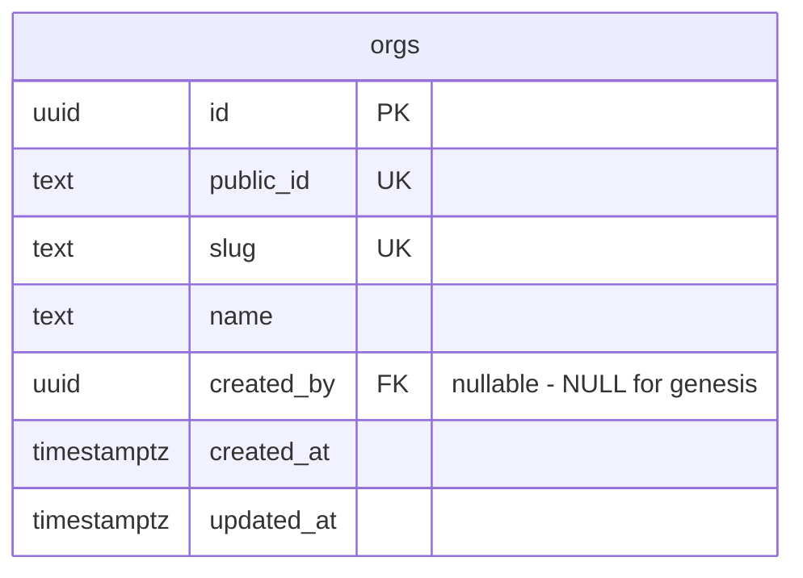

# schema

Postgres migrations for auth-server, run by the app-agnostic `migrator` package
(goose). Files are templates: `{{.Schema}}`, `{{.TablePrefix}}`, `{{.Role}}`.
`Config.Schema` defaults to `public`; a non-empty `Config.Role` runs `SET ROLE`
on the migration connection.



## External migrations

Run another tool's migrations after ours on the same DB:

```go
schema.New(cfg).WithUpgrade("whatsmeow", meow.Upgrade).Up(ctx, db)
```

The external tool owns its tables under a reserved prefix; ours must not use it.
`MigrationsFS()` exposes the raw SQL for a guard test.

## Add a migration

`NNN_<name>.sql` at the next number, bump `VERSION`, write the `Down`.
